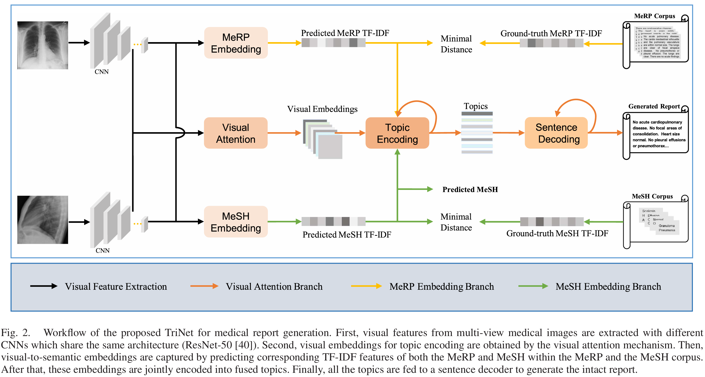

# Joint Embedding of Deep Visual and Semantic Features for Medical Image Report Generation
## 📋 Project Overview

Medical image report generation (MeIRG) aims at generating associated diagnosis descriptions with natural language sentences from medical images, which is essential in the computer-aided diagnosis system. Nevertheless, this task remains challenging in that medical images and linguistic expressions should be understood jointly which however show great discrepancies in the modality. To fill this visual-to-semantic gap, we propose a novel framework that follows the encoder-decoder pipeline. Our framework is characterized by encoding both deep visual and semantic embeddings through a triple-branch network (TriNet) during the encoding phase. The visual attention branch captures attended visual embeddings from medical images with the soft attention mechanism. The medical report (MeRP) embedding branch predicts semantic report embeddings. The embedding branch of medical subject headings (MeSH) obtains semantic embeddings of related medical tags as complementary information. Then, outputs of these branches are fused and fed into a decoder for the report generation. Experimental results on two benchmarkdatasets have demonstrated the excellent performance of our method. Related codes are available at https://github.com/yangyan22/Medical-Report-Generation-TriNet.

<div align=center></div>

## 🔧 Dependencies
  - Python=3.7.3
  - pytorch=1.8.1
  - pickle
  - tqdm
  - time
  - argparse
  - matplotlib
  - sklearn
  - json
  - numpy 
  - torchvision 
  - itertools
  - collections
  - math
  - os
  - matplotlib
  - PIL 
  - itertools
  - copy
  - re
  - abc
  - pandas
  - torch

The ground-truth TF-IDF features of MeSH and MeRP in the training set are constructed before training with codes in TF-IDF folder.

The IF-IDF folder contains:
 1. the build_vocab_TF-IDF.py (for constructing the vocabulary in TF-IDF construction with a vocab_TF-IDF.json)
 2. mesh_tag.py (to select the top 30 MeSH and obtain the MeSH information for each study)
 3. TF_IDF_MeRP.py (to construct the report TF-IDF vector for each study)
 4. TF_IDF_MeSH.py (to construct the MeSh TF-IDF vector for each study)

## 🎯 reference codes: 
https://github.com/ZexinYan/Medical-Report-Generation

https://github.com/tylin/coco-caption

https://github.com/MorvanZhou/NLP-Tutorials

## the metric meteor
the paraphrase-en.gz should be put into the .\pycocoevalcap\meteor\data, since the file is too big to upload.


## ✅ Citation

If you find our codes useful in your research, please cite our paper:

```
@ARTICLE{9606584,
  author={Yang, Yan and Yu, Jun and Zhang, Jian and Han, Weidong and Jiang, Hanliang and Huang, Qingming},
  journal={IEEE Transactions on Multimedia}, 
  title={Joint Embedding of Deep Visual and Semantic Features for Medical Image Report Generation}, 
  year={2023},
  volume={25},
  number={},
  pages={167-178},
  doi={10.1109/TMM.2021.3122542}}
```

